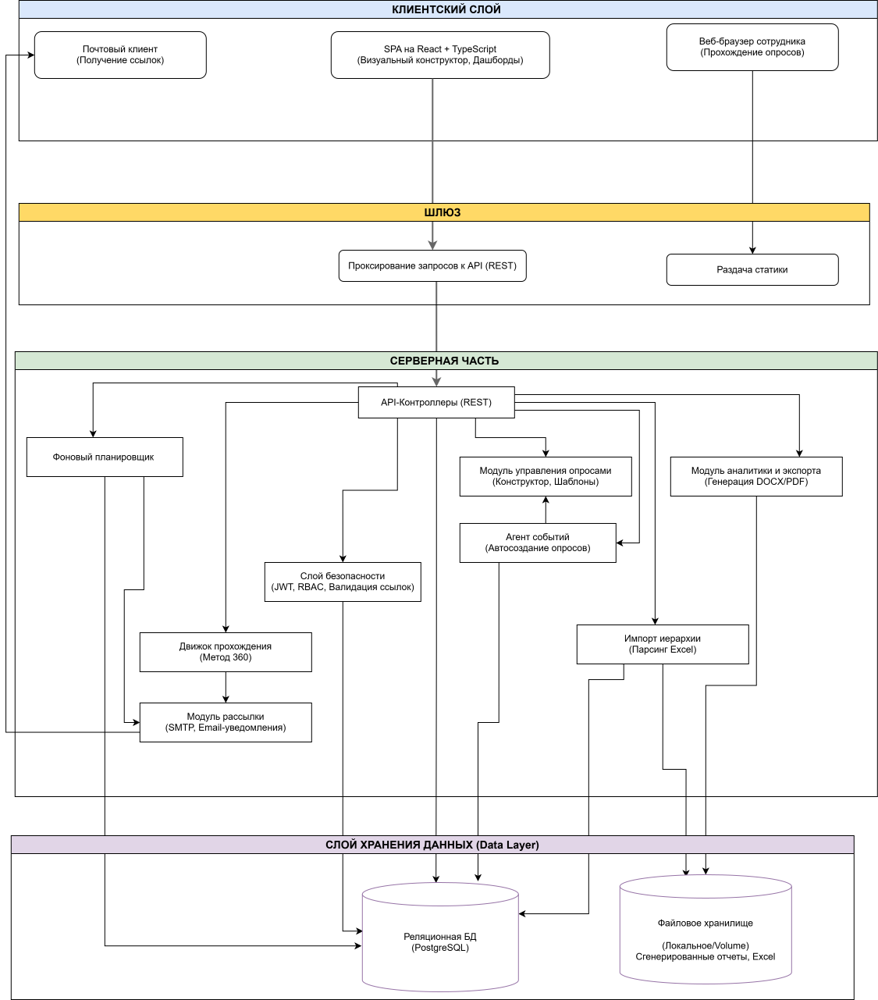
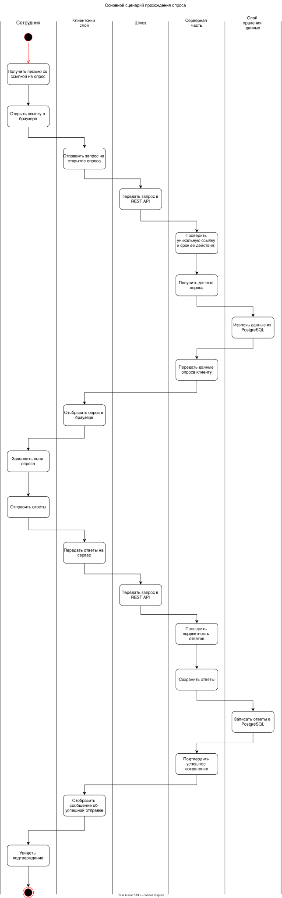
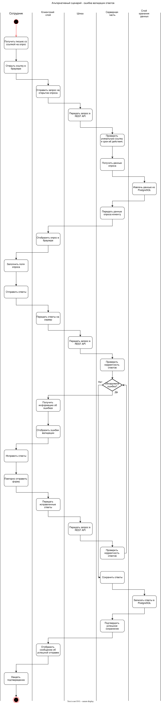
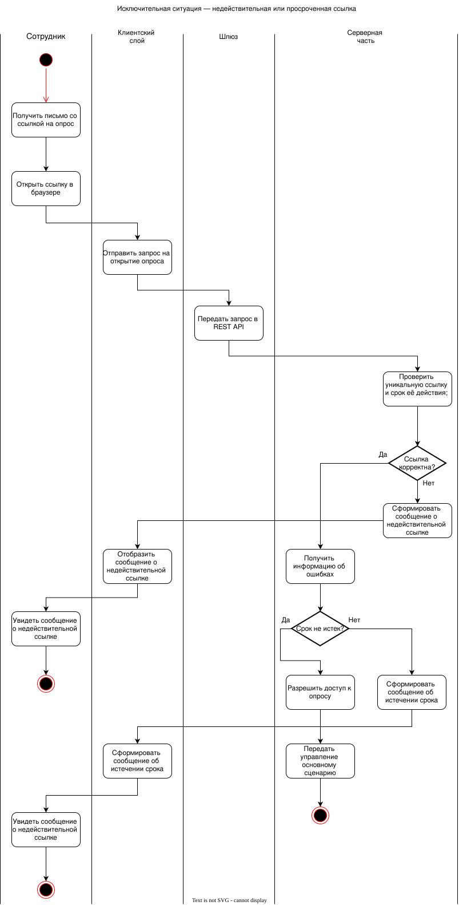
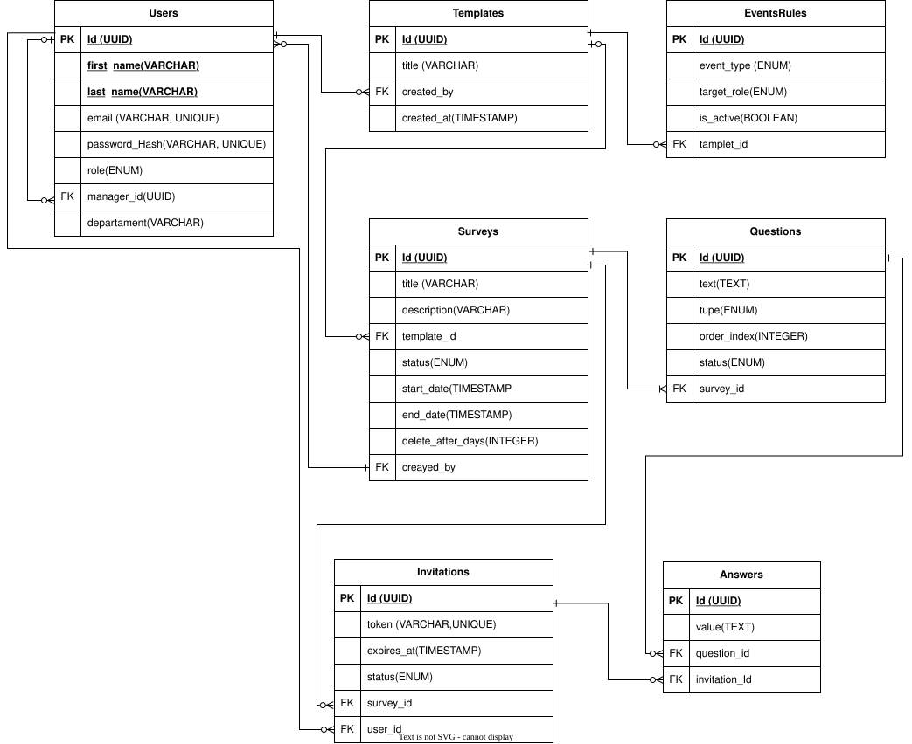

# Лабораторная работа №2. Архитектура и проектирование системы

Тема: Разработка корпоративной платформы сбора и анализа обратной связи сотрудников (на примере ООО «Директум»)

Состав команды: 2 человека (командный вариант — 3 диаграммы активности).

---

## 1. Структурная схема системы

Система построена по трёхуровневой архитектуре: клиент → API-слой → данные . 

*   Клиентский слой (Frontend):
    *   SPA на React + TypeScript: Предоставляет графический интерфейс для HR-специалистов (создание опросов, настройка шаблонов, дашборды) и Руководителей (просмотр результатов подчиненных).
    *   Веб-браузер сотрудника: Упрощенный интерфейс, открываемый по уникальной ссылке из письма, для прохождения опросов без необходимости авторизации.
*   Слой маршрутизации (API Gateway):
    *   Nginx (Reverse Proxy): Выполняет роль единой точки входа. Обеспечивает раздачу статических файлов (React), терминацию SSL-сертификатов (HTTPS) и проксирование API-запросов к бэкенду.
*   Серверная часть / Ядро (Backend - Java Spring Boot):
    *   API-Контроллеры (REST): Принимают HTTP-запросы от клиентов, валидируют входные данные и делегируют выполнение бизнес-логике.
    *   Слой безопасности (Spring Security): Реализует RBAC (Role-Based Access Control), проверку JWT-токенов, защиту от несанкционированного доступа и валидацию пригласительных ссылок.
    *   Модуль управления опросами и шаблонами: Отвечает за CRUD-операции с опросами, применение шаблонов и логику метода 360.
    *   Движок прохождения опросов: Обрабатывает ответы сотрудников, проверяет статусы приглашений и сохраняет результаты.
    *   Модуль аналитики и экспорта: Формирует сводные отчеты, фильтрует данные по иерархии (руководитель видит только своих) и генерирует файлы DOCX/PDF.
    *   Агент событий (Webhook-сервис): Принимает внешние сигналы (например, от 1С об успешной аттестации) и инициирует создание опросов.
    *   Модуль импорта иерархии: Парсит Excel-файлы для построения дерева подчиненности сотрудников (связи `manager_id`).
    *   Модуль рассылки (Email Service): Формирует и отправляет письма с приглашениями и напоминаниями через корпоративный SMTP-сервер.
    *   Фоновый планировщик (Scheduler): Выполняет задачи по расписанию (автоудаление данных по 152-ФЗ, отправка напоминаний, проверка календарных событий для новичков).
*   Слой хранения данных (Data Layer):
    *   Реляционная БД (PostgreSQL): Хранит структурированные данные (пользователи, опросы, вопросы, ответы, логи событий).
    *   Файловое хранилище (Docker Volume): Используется для временного хранения загружаемых Excel-файлов и сгенерированных отчетов.

## 2. Технологический стек

При разработке системы используются следующие технологии (стек согласован с заказчиком):

*  Backend (Серверная часть) Java 21, Spring Boot 3 (Spring Web, Spring Security, Spring Data JPA).
*  Frontend (Клиентская часть) React 18, TypeScript, React Router (навигация), Axios (HTTP-клиент).
*  База данных PostgreSQL 16.
*  Миграции БД Flyway (или Liquibase).
*  Инфраструктура и развертывание Linux (Ubuntu), Docker, Docker Compose, Nginx.
*  Аутентификация JWT (JSON Web Tokens).
*  Работа с документами Apache POI (чтение Excel), Docx4j или OpenPDF (генерация отчетов).
*  Сборка проектов Maven (для Java), Vite или Webpack (для React).
*  Документирование API Swagger / OpenAPI (springdoc-openapi).
*  Тестирование JUnit 5, Mockito (бэкенд), React Testing Library (фронтенд).

## 3. Диаграммы UML

В рамках проектирования системы была разработана диаграмма вариантов использования (Use Case Diagram), которая отражает функциональные требования к системе и взаимодействие пользователей с ней.

### 3.1. Диаграмма вариантов использования (Use Case)

Диаграмма описывает границы системы (Корпоративная платформа опросов), основных и вторичных акторов, а также доступные им прецеденты. 

Описание элементов диаграммы:
На диаграмме отражены все ключевые прецеденты (`UC-01` – `UC-12`), выделенные на этапе анализа требований. Для отображения общей логики использованы связи `<<include>>` (например, обязательная проверка прав RBAC при управлении опросами) и `<<extend>>` (например, вывод ошибок при валидации Excel-файла).

#### Таблица 1 – Пользователи системы (Акторы)

| Код актора | Пользователь (Актор) | Описание роли | Основные возможности |
| :--- | :--- | :--- | :--- |
| ACT-01 | Сотрудник | Участник внутренних опросов. | Прохождение опроса по уникальной ссылке, сохранение ответов, просмотр истории. |
| ACT-02 | Руководитель подразделения | Линейный менеджер, контролирующий процесс в своей команде. | Инициирование опроса по запросу, просмотр результатов и сводок только по своим подчиненным. |
| ACT-03 | HR-специалист | Основной пользователь, администрирующий систему. | Управление опросами и шаблонами, импорт иерархии, настройка автосоздания, просмотр/экспорт результатов, удаление данных. |
| ACT-04 | Внешняя HR-система (1С) | Корпоративная система учета кадров. | Отправка Webhook-событий (например, «Аттестация пройдена») для запуска автосоздания опросов. |

#### Таблица 2 – Перечень прецедентов (Use Cases)

| Код | № | Пользователь (Актор) | Название прецедента | Что входит в прецедент |
| :--- | :--- | :--- | :--- | :--- |
| UC-01 | 1 | Сотрудник | Пройти опрос | Просмотр назначенных опросов, прохождение, отправка ответов. |
| UC-02 | 2 | Сотрудник | Просмотр истории опросов | Просмотр списка пройденных и активных опросов в личном кабинете. |
| UC-03 | 3 | Руководитель | Инициировать опрос | Создание запроса на опрос для своих подчиненных. |
| UC-04 | 4 | Руководитель | Просмотреть результаты подчиненных | Запрос доступа, просмотр результатов и сводок по своему подразделению. |
| UC-05 | 5 | HR-специалист | Управлять опросами | Создание, редактирование, предпросмотр, назначение участников и запуск опроса. |
| UC-06 | 6 | HR-специалист | Управлять шаблонами | Создание и редактирование шаблонов опросов. |
| UC-07 | 7 | HR-специалист | Настроить автосоздание опросов | Настройка правил автоматического запуска по событиям и настройка опроса 360. |
| UC-08 | 8 | HR-специалист | Импортировать иерархию из Excel | Загрузка структуры подразделений и сотрудников. |
| UC-09 | 9 | HR-специалист | Просмотреть и экспортировать результаты | Просмотр всех результатов, управление доступом к ним и экспорт в файл. |
| UC-10 | 10 | HR-специалист | Удалить данные опросов | Ручное удаление, настройка срока хранения, удаление после экспорта (152-ФЗ). |
| UC-11 | 11 | HR-специалист | Отслеживать рассылку | Просмотр статуса рассылки и отправленных напоминаний. |
| UC-12 | 12 | Внешняя HR-система | Обработать внешнее событие (Webhook) | Прием сигнала от 1С для автосоздания опроса. *(Системный прецедент)* |
### 3.2. Диаграмма активности

### 3.3. Диаграмма активности

### 3.4. Диаграмма активности

## 4. ER-диаграмма (модель данных)

Для хранения данных используется реляционная база данных PostgreSQL. Модель данных спроектирована с учетом требований по разграничению доступа (RBAC), поддержке иерархии подразделений и безопасному хранению ответов (152-ФЗ). 

### 4.1. Описание сущностей (Таблиц)

1. Users (Пользователи) — хранит учетные записи всех участников. 
   * Поле `manager_id` реализует рекурсивную связь (самоссылку) для построения дерева подчиненности (кто чей руководитель). 
   * Поле `role` определяет права доступа (HR, MANAGER, EMPLOYEE).
2. Templates (Шаблоны) — библиотека типовых опросов, создаваемых HR-специалистами.
3. Surveys (Опросы) — конкретные экземпляры опросов. Хранит статус (черновик, активен, завершен), даты начала/окончания и настройки автоудаления.
4. Questions (Вопросы) — список вопросов, привязанных к конкретному опросу, с указанием типа (текст, выбор, шкала).
5. Invitations (Приглашения) — генерируемые уникальные токены (ссылки), которые отправляются сотрудникам по email. Хранит статус прохождения (отправлено, пройдено, просрочено).
6. Answers (Ответы) — сами ответы сотрудников. Привязываются к конкретному приглашению и вопросу.
7. EventRules (Правила автоматизации) — настройки для «Агента событий», которые определяют, при каком внешнем событии (например, успешная аттестация) и какой шаблон нужно запустить.

### 4.2. Описание связей (Relationships)

В модели реализованы следующие типы связей:

* Users (1) ➔ Users (M) *(Ноль или один — Ноль или много)*: Рекурсивная связь через `manager_id`. Один руководитель может иметь много подчиненных, но у каждого сотрудника может быть только один прямой руководитель (или ни одного, если это директор).
* Users (1) ➔ Templates (M) *(Один — Ноль или много)*: Один HR-специалист может создать множество шаблонов. Каждый шаблон обязательно имеет автора.
* Users (1) ➔ Surveys (M) *(Один — Один или много)*: HR создает опросы. Опрос не может существовать без создателя.
* Templates (1) ➔ Surveys (M) *(Ноль или один — Ноль или много)*: Опрос может быть создан на основе шаблона, а может быть создан с нуля (тогда связь NULL).
* Surveys (1) ➔ Questions (M) *(Один — Один или много)*: В одном опросе обязательно есть хотя бы один вопрос. Вопрос не может существовать вне опроса (каскадное удаление).
* Surveys (1) ➔ Invitations (M) *(Один — Ноль или много)*: На один опрос может быть разослано множество приглашений. У черновика опроса приглашений нет (ноль).
* Users (1) ➔ Invitations (M) *(Один — Ноль или много)*: Приглашение адресуется конкретному сотруднику. Один сотрудник может получить много приглашений на разные опросы.
* Invitations (1) ➔ Answers (M) *(Один — Ноль или много)*: В рамках одного приглашения (одной сессии прохождения) сотрудник дает ответы на несколько вопросов.
* Questions (1) ➔ Answers (M) *(Один — Ноль или много)*: Один вопрос собирает множество ответов от разных респондентов.
* Templates (1) ➔ EventRules (M) *(Один — Ноль или много)*: Правило автоматизации ссылается на конкретный шаблон, который нужно применить. Шаблон может не использоваться ни в одном правиле.

### 4.3. Обеспечение безопасности данных (152-ФЗ)

При проектировании БД заложены следующие принципы безопасности:
* Пароли хранятся исключительно в виде криптографических хешей (BCrypt), что исключает их кражу при компрометации БД.
* Персональные данные (ФИО, email) хранятся в открытом виде для обеспечения работы бизнес-логики (рассылки, отчеты), однако доступ к БД ограничен сетевым контуром приложения.
* Каскадное удаление: при удалении опроса (по истечении срока или после экспорта) все связанные вопросы, приглашения и ответы безвозвратно удаляются из БД.

## 5. Описание программных интерфейсов взаимодействия компонент

Взаимодействие между клиентской частью (React SPA) и серверной частью (Java Spring Boot) осуществляется по архитектурному стилю REST с использованием формата данных JSON. Передача данных происходит по протоколу HTTP/HTTPS. Для авторизации используется передача JWT-токена в заголовке `Authorization: Bearer <token>`.

Базовый URL API: 
* Среда разработки (локально): `http://localhost:8080/api/v1`
* Среда эксплуатации (за Nginx): `https://survey.directum.local/api/v1`

### 5.1. Соглашения по форматам данных
* Все запросы и ответы передаются в кодировке `UTF-8`.
* Даты передаются в формате ISO 8601 (например, `2026-11-19T17:00:00Z`).
* При успешном выполнении операции сервер возвращает HTTP-код `200 OK` (или `201 Created`).
* При ошибках валидации возвращается `400 Bad Request` с телом ошибки, при ошибках авторизации — `401 Unauthorized` или `403 Forbidden`.

### 5.2. Основные API-контракты

Ниже приведены сигнатуры ключевых методов (эндпоинтов), реализующих бизнес-логику системы в соответствии с прецедентами.

#### 1. Модуль аутентификации и авторизации (RBAC)
Эндпоинты для входа в систему и получения JWT-токена. Используются HR-специалистами и Руководителями для доступа к закрытым разделам.

*   `POST /auth/login`
    *   Описание: Аутентификация пользователя по email и паролю.
    *   Request: `{"email": "hr@directum.ru", "password": "password123"}`
    *   Response (200 OK): `{"token": "eyJhbGciOi...", "role": "HR", "firstName": "Иван"}`

#### 2. Модуль управления опросами (Прецеденты №5, №6)
Эндпоинты для создания, редактирования и запуска опросов. Доступны только роли `HR`.

*   `GET /surveys`
    *   Описание: Получение списка всех опросов (с фильтрацией по статусу: `DRAFT`, `ACTIVE`).
    *   Response (200 OK): Массив объектов опросов.
*   `POST /surveys`
    *   Описание: Создание нового опроса (черновика).
    *   Request: `{"title": "Опрос новичка", "templateId": "uuid-шаблона", "endDate": "2026-12-01T23:59:59Z"}`
    *   Response (201 Created): `{"id": "uuid-опроса", "status": "DRAFT"}`
*   `PUT /surveys/{id}`
    *   Описание: Редактирование параметров опроса (пока он в статусе `DRAFT`).
*   `POST /surveys/{id}/launch`
    *   Описание: Запуск опроса. Генерирует уникальные токены для всех назначенных сотрудников и инициирует email-рассылку.
    *   Response (200 OK): `{"status": "ACTIVE", "invitationsGenerated": 150}`
*   `DELETE /surveys/{id}`
    *   Описание: Ручное удаление опроса (Прецедент №10). Каскадно удаляет все связанные вопросы и ответы.

#### 3. Модуль управления шаблонами (Прецедент №6)
Эндпоинты для работы с библиотекой шаблонов (HR).

*   `GET /templates`
    *   Описание: Получение списка доступных шаблонов.
*   `POST /templates`
    *   Описание: Создание нового шаблона (с вопросами).
    *   Request: `{"title": "Шаблон 360", "questions": [{"text": "Оцените коллегу", "type": "SCALE"}]}`
*   `POST /templates/{id}/archive`
    *   Описание: Архивирование устаревшего шаблона (чтобы скрыть его из выпадающих списков, не ломая уже созданные опросы).

#### 4. Модуль прохождения опроса (Прецеденты №1, №13)
Публичные эндпоинты (без JWT-авторизации), доступные по уникальной ссылке из письма.

*   `GET /public/surveys/take/{token}`
    *   Описание: Валидация токена и получение вопросов для прохождения.
    *   Response (200 OK): `{"surveyTitle": "Адаптация", "questions": [{"id": "q-1", "text": "Все ли вам понятно?", "type": "TEXT"}]}`
    *   Response (403 Forbidden): Если токен просрочен или опрос уже пройден.
*   `POST /public/surveys/take/{token}`
    *   Описание: Сохранение ответов сотрудника.
    *   Request: `{"answers": [{"questionId": "q-1", "value": "Да, все понятно"}]}`
    *   Response (200 OK): `{"message": "Ответы сохранены"}`

#### 5. Модуль аналитики и отчетов (Прецеденты №4, №9)
Эндпоинты для просмотра результатов (HR и Руководители). Фильтрация данных происходит автоматически в зависимости от роли пользователя (RBAC).

*   `GET /results`
    *   Описание: Получение агрегированных результатов опросов. Руководитель видит только результаты своих подчиненных.
    *   Query params: `?surveyId=uuid&department=IT`
    *   Response (200 OK): `{"totalInvited": 100, "completed": 80, "averageRating": 4.5}`
*   `GET /results/{surveyId}/export`
    *   Описание: Генерация и скачивание отчета в формате DOCX/PDF. При скачивании срабатывает логика удаления данных (152-ФЗ).
    *   Response: Бинарный файл (`application/vnd...`).

#### 6. Модуль интеграции и автоматизации (Прецеденты №7, №12)
Эндпоинты для настройки правил и приема событий из внешних систем.

*   `GET /rules`
    *   Описание: Просмотр настроенных правил автосоздания опросов.
*   `POST /rules`
    *   Описание: Создание нового правила (например, «Запуск опроса через 3 месяца после найма»).
    *   Request: `{"eventType": "NEWBIE_3_MONTHS", "templateId": "uuid", "targetRole": "MANAGER"}`
*   `POST /webhooks/hr-system`
    *   Описание: Прием сигнала от внешней системы (1С). Система ищет подходящее правило и создает опрос.
    *   Request: `{"eventType": "CERTIFICATION_PASSED", "employeeId": "emp-123"}`

#### 7. Модуль импорта сотрудников (Прецедент №8)
*   `POST /employees/import`
    *   Описание: Загрузка файла Excel с оргструктурой.
    *   Request: `multipart/form-data` (файл `.xlsx`).
    *   Response (200 OK): `{"status": "SUCCESS", "added": 50, "updated": 10, "errors": []}`

## 7. Создание интерактивного прототипа в коде с участием ИИ-агента

 Прототип является исполнимым и реализует навигацию по ключевым сценариям системы.

### 7.1. Реализованные экранные формы
На основе ранее согласованных Wireframes  в коде были реализованы следующие страницы:
1.  Дашборд опросов (SurveysPage): Главный экран HR со списком опросов, поиском и кнопкой создания.
2.  Конструктор опроса (CreateSurveyPage): Динамическая форма для добавления вопросов и вариантов ответов.
3.  Выбор участников (SelectParticipantsPage): Таблица сотрудников с фильтрацией и чекбоксами для рассылки.
4.  Результаты (ResultsPage): Экран аналитики с агрегированными данными и кнопкой экспорта в DOCX/PDF.
5.  Результаты подразделения (DepartmentResultsPage): Интерфейс для Руководителя с ограниченным доступом (RBAC).
6.  Шаблоны и Настройки: Вспомогательные экраны для управления библиотекой шаблонов и интеграциями (SMTP, Webhook).

Навигация между экранами реализована с помощью библиотеки `react-router-dom`. Переходы осуществляются как через боковое меню (Sidebar), так и по действиям пользователя (например, клик на кнопку «Создать опрос» переводит на страницу конструктора).

### 7.2. Работа с ИИ-агентом при генерации кода
Для ускорения разработки прототипа активно использовался ИИ-агент (ChatGPT / Claude). Ниже приведены примеры постановки задач и внесенных корректировок.

Пример 1: Генерация каркаса страницы
*   Промпт: *«Напиши React-компонент SurveysPage на TypeScript. Используй MUI. Сверху должен быть заголовок "Опросы", под ним кнопка "Создать опрос" и таблица со списком опросов (колонки: Название, Статус, Дата, Участники). Добавь поле поиска, которое фильтрует таблицу по названию».*
*   Результат агента: Агент сгенерировал базовый код с маппингом массива `mockSurveys` и стейтом для поиска.
*   Корректировка: Агент забыл обработать регистр букв при поиске (поиск работал только с точным совпадением). Студент вручную добавил `.toLowerCase()` в функцию фильтрации.

Пример 2: Конструктор опросов
*   Промпт: *«Сделай компонент для добавления вопросов. Каждый вопрос должен иметь текстовое поле, выпадающий список типа (текст, выбор, шкала) и кнопку добавления вариантов ответа. Если выбран тип "текст", варианты скрываются».*
*   Результат агента: Агент предложил сложную структуру с вложенными стейтами.

## 8. Документирование архитектурных решений (ADR)

В соответствии с методикой Architecture Decision Records (ADR), ниже зафиксированы 5 ключевых решений, принятых при проектировании системы.

### ADR-001: Выбор фреймворка для бэкенда (Java Spring Boot)
Статус: Принято
Контекст: В исходном ТЗ заказчика был указан стек ASP.NET Core 8. Однако команда не имела опыта промышленной разработки на C#. Требование FR-01 (создание опросов) и NFR-02 (высокая нагрузка) требовали надежного и производительного бэкенда.
Рассмотренные альтернативы:
1.  *ASP.NET Core 8:* Соответствует ТЗ, но высокий порог входа для команды (отклонено из-за риска срыва сроков).
2.  *Node.js (Express/NestJS):* Быстрый старт, но слабая типизация для сложной бизнес-логики (отклонено).
3.  *Python (Django/FastAPI):* Хорош для быстрых прототипов, но уступает в корпоративной надежности (отклонено).  
  
Принятое решение: Используем Java 21 + Spring Boot 3. Стек согласован с заказчиком, обеспечивает строгую типизацию и имеет встроенные модули безопасности (Spring Security).
Последствия:
*   *Упрощается:* разработка благодаря опыту команды; безопасность (Spring Security).
*   *Усложняется:* развертывание по сравнению с легковесным Node.js (требуется JVM).
*   *Риски:* заказчик может потребовать строгого соответствия исходному ТЗ (C#), но разрешение на смену стека было получено письменно.
Роль агента: Агент сгенерировал сравнительную таблицу характеристик (производительность, потребление памяти, экосистема) для Spring Boot и ASP.NET Core. На основе этих данных команда приняла решение отказаться от C# в пользу знакомого стека.

### ADR-002: Выбор реляционной базы данных
Статус: Принято
Контекст: Система должна хранить структурированные данные (сотрудники, опросы, ответы). Требование NFR-01 (безопасность 152-ФЗ) требует надежного удаления данных и разграничения доступа.
Рассмотренные альтернативы:
1.  *MongoDB:* Гибкая схема, но сложная реализация каскадного удаления и связей «многие-ко-многим» (отклонено).  
2.  *SQLite:* Простота, но плохая масштабируемость при росте базы знаний (отклонено).  
  
Принятое решение: Используем PostgreSQL. Она идеально подходит для иерархических структур (рекурсивные запросы для `manager_id`) и поддерживает строгие транзакции.
Последствия:
*   *Упрощается:* целостность данных, построение сложных отчетов с JOIN.
*   *Усложняется:* необходимость написания миграций (Flyway) при изменении схемы.
*   *Риски:* при росте нагрузки потребуется оптимизация индексов.
Роль агента: Агент предложил три варианта (PostgreSQL, MongoDB, Redis) и сравнил их по скорости поиска. Команда скорректировала выбор агента, отдав предпочтение PostgreSQL из-за необходимости строгих связей.

### ADR-003: Выбор способа авторизации (JWT)
Статус: Принято
Контекст: Сотрудник должен проходить опрос по уникальной ссылке без ввода пароля (Прецедент UC-01), а HR и Руководитель — иметь доступ к административной панели (RBAC).
Рассмотренные альтернативы:
1.  *Сессии на сервере (Cookies):* Требует хранения состояния на сервере, что усложняет горизонтальное масштабирование (отклонено).
2.  *OAuth 2.0 / ADFS:* Слишком сложно для MVP, заказчик сам просил сделать первую версию без ADFS (отклонено).  
  
Принятое решение: Используем JWT (JSON Web Tokens) для HR и Руководителей. Для сотрудников — генерация уникальных UUID-токенов в ссылках без необходимости входа в систему.
Последствия:
*   *Упрощается:* масштабирование (сервер не хранит сессии); прохождение опросов без пароля.
*   *Усложняется:* отзыв токена возможен только через истечение срока действия (или черный список).
*   *Риски:* если JWT украдут, злоумышленник получит доступ до истечения токена.
Роль агента: Агент объяснил разницу между сессиями и токенами, а также помог сгенерировать структуру безопасной ссылки для прохождения опроса. Команда дополнила решение требованием использования HTTPS.

### ADR-004: Выбор архитектуры фронтенда (SPA на React)
Статус: Принято
Контекст: Интерфейс должен быть интерактивным, с динамическим конструктором опросов и дашбордами. Требование NFR-05 (SUS ≥ 70) диктует высокие требования к UX.
Рассмотренные альтернативы:
1.  *Server-Side Rendering (Next.js):* Усложняет архитектуру, так как серверная часть на Java (отклонено).
2.  *Vue.js:* Обладает меньшим количеством готовых библиотек для таблиц и дашбордов, необходимых для проекта (отклонено)  
  
Принятое решение: Используем React 18 + TypeScript в связке с Vite для быстрой сборки. Для UI используем библиотеку Material UI (MUI).
Последствия:
*   *Упрощается:* создание сложных интерактивных форм (конструктор); готовые UI-компоненты MUI.
*   *Усложняется:* SEO-оптимизация .
*   *Риски:* размер бандла (MUI добавляет вес), но для корпоративной сети это не проблема.
Роль агента: Агент сгенерировал базовую структуру проекта (Layout, Sidebar, роутинг) и предложил использовать MUI для ускорения верстки. Студенты скорректировали дизайн под фирменный стиль (светло-серый фон меню).

### ADR-005: Инфраструктура развертывания (Docker + Nginx)
Статус: Принято
Контекст: ТЗ требует развертывания в контуре заказчика (Linux). Требование NFR-04 (развертывание одной командой) и NFR-01 (безопасность) диктуют требования к инфраструктуре.
Рассмотренные альтернативы:
1.  *Ручная установка (Java + Node.js + Nginx на хост):* Сложно поддерживать, высокий риск конфликта версий (отклонено).
2.  *Kubernetes:* Избыточно для проекта масштаба одного предприятия (отклонено).  
  
Принятое решение: Используем Docker и Docker Compose. Nginx выступает в роли Reverse Proxy: раздает статику React и проксирует API-запросы к Spring Boot.
Последствия:
*   *Упрощается:* развертывание (одна команда `docker compose up`); изоляция сервисов.
*   *Усложняется:* необходимость настройки Nginx (конфиги) и Dockerfile для сборки.
*   *Риски:* если контейнер с БД упадет без Volume, данные могут потеряться (решено настройкой Docker Volumes).
Роль агента: Агент сгенерировал шаблоны `Dockerfile` для Java и React, а также базовый конфиг `nginx.conf`. Команда вручную доработала конфиг Nginx для правильной обработки CORS и перенаправления запросов на бэкенд.